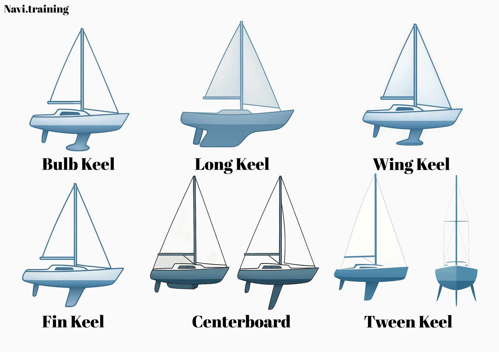
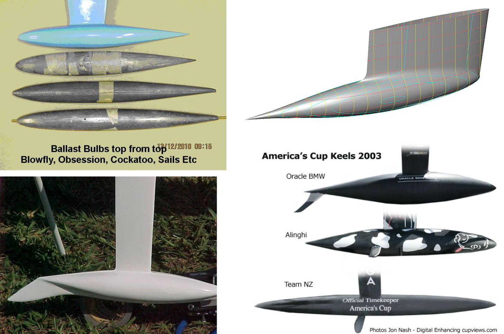

# Modelling a keel fin and bulb

::: {.lesson-meta}
**Exercise 3 · About 90 minutes of Rhino work, plus web research · Complete Exercise 1 first**

**Your model:** a tapered, symmetric keel fin with a revolved bulb. You will research real keel proportions, choose your own dimensions, import an airfoil profile, loft the fin and check a Boolean union.

Adapted and extended from [*Modelling keel fin and keel bulb*](https://jobasic-geometry.curve.space/modelling-keel-fin-and-keel-bulb), Josip Bašić, 3 November 2025. This is a geometry exercise, not a hydrodynamic or production keel design.
:::

## Before you start

Use Rhino 8 and set document units to **metres**, absolute tolerance to **0.001 m**, and angle tolerance to **1 degree**. Use the course convention: **X forward, Y to port, Z upward**, with the centreplane at **Y = 0**. Top is the XY plan view and Front is the XZ profile view.

The keel is modelled as a separate component. Its root profile sits at the hull attachment plane, Z = 0; the exercise does not include the hull. Here, **fin span** means the distance from that root plane to the fin-tip plane. The ballast bulb extends below the fin tip, so overall keel depth is greater than fin span. A **station** is a profile curve at a particular height. The airfoil chord runs along X, its thickness is symmetric about Y = 0, and the fin span runs downward along negative Z.

## 1. Research keel proportions

Before opening Rhino, browse specifications, class rules, manufacturer pages and dimensioned drawings for **at least two sailing boats**. Include at least one fin keel with a ballast bulb. Allow about 20–30 minutes for the research, record each source URL and the date you checked it, and bring your worksheet to the modelling session. Prefer published dimensions and drawings over photographs.

Starter sources:

- The [World Sailing RC44 class rules](https://www.sailing.org/document/rc44-class-rules-2023-03mar-01/) include keel section chords and bulb offsets in Appendix D. The [44Cup RC44 technical data](https://www.44cup.org/44Cup/technical-data) provides hull dimensions and identifies the lead-antimony bulb. Read the dimensions and datums carefully: this is a high-performance one-design example, not a universal proportion guide.
- [International Star Class 2025 specifications](https://starclass.org/assets/documents/other_documents/2025-Specifications.pdf) publish hull dimensions and keel-specific measurements. In particular, compare the definitions for K-2, K-4, K-6 and K-7; each uses a different datum or feature.
- [J/Boats J/70 specifications](https://jboats.com/spectables/j70_spec.html) publish LOA, beam and standard draft. This table is useful for hull proportions, but it does not give all keel-profile dimensions.
- [ERYD Open specifications](https://eryd.com/en/eryd-open/) give length, width, draft and identify a lead-antimony bulb. Use a plan or other source if you need keel-specific measurements.

These are starting points, not a universal design standard. Published draft is measured from the waterline to the boat's lowest point; it is **not automatically the keel span**. Use the dimension definition and datum in each source. A keel can also include a bulb below the fin.

### Research worksheet

Fill one row for each boat. Use metres; note the original units if you convert them.

| Boat and keel type | LOA, \(L\) | Beam, \(B\) | Published draft, \(T\) | Overall keel depth, \(D_k\), and datum | Fin span, root plane to fin tip | Source URL and page |
|---|---:|---:|---:|---|---|
| Boat 1 |  |  |  |  |  |
| Boat 2 |  |  |  |  |  |

Then record keel-specific dimensions where your sources provide them. In this exercise, root chord is the leading-to-trailing distance where the fin meets the hull; tip chord is that distance at the fin tip. Db is the bulb's maximum diameter. If a source gives separate bulb height and breadth, record both and choose a representative diameter for this simplified revolved bulb. Write **not published** where a source gives no value; do not infer a measured value from an undimensioned photograph. Overall keel depth to the bulb bottom and fin span from the hull attachment plane to the fin tip are different measurements.

| Boat | Fin root chord, \(C_r\) | Fin tip chord, \(C_t\) | Fin span, \(S\) | Bulb length, \(L_b\) | Maximum bulb diameter, \(D_b\) | Source or measurement method |
|---|---:|---:|---:|---:|---|
| Boat 1 |  |  |  |  |  |
| Boat 2 |  |  |  |  |  |

Calculate ratios that let you compare boats of different sizes:

| Ratio | What it compares |
|---|---|
| \(B/L\) | Hull beam to LOA |
| \(T/L\) | Published draft to LOA; keep this separate from keel span |
| \(S/L\) | Fin span from root plane to fin tip, divided by LOA |
| \(D_k/L\) | Overall keel depth to LOA, only when that separate dimension is published |
| \(C_r/L\) | Root chord to LOA |
| \(C_t/C_r\) | Tip chord to root chord |
| \(s/C_r\) | Tip leading-edge sweep to root chord, where a plan or drawing provides this measurement |
| \(L_b/C_r\) | Bulb length to root chord |
| \(D_b/C_r\) | Bulb diameter to root chord |

### Choose the model proportions

Use the ratios you found to make a proportioned keel for this exercise. You can interpolate between examples or choose a different combination, but record why your choices are plausible relative to your sources. If a fin span is not published, estimate it from a scaled, dimensioned drawing and label it **estimated**. Do not substitute overall keel depth or boat draft for fin span, and do not call an estimate a published boat dimension.

Choose one reference LOA as your model length \(L\), or use another clearly stated scale. Then fill in this table. Round model dimensions to three decimals before entering them in Rhino.

| Model parameter | How to choose or calculate it | Your value |
|---|---|---:|
| Reference length, \(L\) | LOA of your chosen reference boat |  |
| Root chord, \(C_r\) | Your chosen \(C_r/L\) multiplied by \(L\) |  |
| Tip/root ratio, \(q\) | Choose using your comparison of \(C_t/C_r\); use \(0<q<1\) for this tapered-fin exercise |  |
| Tip chord, \(C_t\) | \(q C_r\) |  |
| Fin span, \(S\) | Your chosen \(S/L\) multiplied by \(L\) |  |
| Tip leading-edge sweep, \(s\) | Choose \(s/C_r\), then multiply by \(C_r\); positive \(s\) moves aft |  |
| Bulb length, \(L_b\) | Choose \(L_b/C_r\), then multiply by \(C_r\) |  |
| Bulb maximum diameter, \(D_b\) | Choose \(D_b/C_r\), then multiply by \(C_r\) |  |

These are student-selected geometry values informed by research, not design recommendations. The provided profile is a **unit-chord NACA 0012**; it sets the section shape, not the keel dimensions.

{fig-alt="Six labelled keel arrangements: bulb keel, long keel, wing keel, fin keel, centreboard and twin keel."}

*Figure 1. Keel types shown in the source lesson. This exercise builds the fin-and-bulb arrangement.*

{fig-alt="A collage of ballast bulbs and keel examples, including top-view bulb shapes and a shaded keel model."}

*Figure 2. Bulb and keel examples included in the source lesson; image credits visible in the original are retained.*

The source lesson also links a short [sailing-perspective video on YouTube](https://www.youtube.com/watch?v=PU5i4TyTG70).

<iframe class="course-video" src="https://www.youtube-nocookie.com/embed/PU5i4TyTG70" title="Sailboat Keel Types: 10 Most Common Keels Explained" loading="lazy" referrerpolicy="strict-origin-when-cross-origin" allow="accelerometer; encrypted-media; gyroscope; picture-in-picture; web-share" allowfullscreen></iframe>

## 2. Set up the model

Save the file as **surname_ex03_keel.3dm**. Create these layers before importing or drawing:

| Layer | Contents |
|---|---|
| 10_profile_points | Imported unit-chord points |
| 20_fin | Root and tip profiles, loft and fin solid |
| 30_bulb | Bulb outline and revolved solid |
| 40_checks | Temporary measurements or intersection curves |

Turn **Auto CPlane off**. Before entering the bulb coordinates later, set the Front viewport to **World Front**. Use world-coordinate input (w) for listed points so a changed CPlane does not alter their meaning.

The root profile will be scaled to chord \(C_r\). The copied tip profile will have chord \(C_t\), its leading edge offset aft by \(s\), and its section plane at Z = \(-S\). Keep your chosen dimensions visible as you work.

## 3. Import and close the root profile

Download the [unit-chord NACA 0012 points](../downloads/keel-naca-0012-unit-chord-points.csv). The headerless file contains 41 XYZ rows in this order: normalized chord coordinate \(x/C\), thickness coordinate \(y/C\), and zero \(z/C\). The chord runs from 0 to 1, the section is 12% thick, and the finite trailing-edge gap is closed in Rhino with a line.

1. Make the 10_profile_points layer current and activate **Top** with the World Top CPlane.
2. Choose **File → Import**, select the CSV and use Rhino's point-file importer. Turn **Create point cloud off** so the file becomes individual point objects. Import at the origin without changing the coordinates. [Rhino point-file import](https://docs.mcneel.com/rhino/8/help/en-us/fileio/points_file_asc_csv_txt_xyz_cgo_import.htm).
3. Lock the 10_profile_points layer, make 20_fin current and run **CurveThroughPt**.
4. Select the points one at a time in file order, starting at the upper trailing edge, going around the leading edge and returning along the lower side. Choose **Degree = 3**, **CurveType = Interpolated** and **Knots = Chord**. The result should be one smooth, open curve. [CurveThroughPt reference](https://docs.mcneel.com/rhino/8/help/en-us/commands/curvethroughpt.htm).
5. CurveThroughPt has no **Close=Yes** option. Turn **End Osnap** on, run **Line** between the curve ends, select the line and curve, then run **Join**. Check the result's Properties or **What**: it should be a **closed planar curve**.

Name the closed profile **root**. With the World Top CPlane active, run **Scale** on it about w0,0,0 and enter your value of \(C_r\) as the uniform scale factor. Since the imported chord is one unit long and the document is in metres, the resulting chord is \(C_r\) metres.

::: {.callout-tip title="Checkpoint — root section"}
In Top, the leading edge should remain at w0,0,0 and the trailing edge should be at approximately w{Cr},0,0, where {Cr} means your calculated root chord. The curve should be symmetric about Y = 0 and report as closed. If it has a loop or crossing, undo and reselect the point objects in the order supplied by the CSV.
:::

## 4. Make a smaller, swept tip profile

Copy the closed **root** curve to make **tip**:

1. Select **root** and run **Copy**. Use w0,0,0 for both the base point and destination.
2. With only the duplicate selected, run **Scale**. Use w0,0,0 as the base point and enter \(q=C_t/C_r\) as the uniform scale factor. This preserves the section proportions while making its chord \(C_t\).
3. Run **Move** on the smaller curve. Use w0,0,0 as the base point and w{s},0,-{S} as the destination, replacing the symbols with your calculated values. This moves its leading edge aft by \(s\) and down by \(S\).
4. Name the moved profile **tip** and keep it on the 20_fin layer.

Inspect the curves in Top, Front and Perspective. The root is at Z = 0 and the tip is at Z = \(-S\). Their leading edges should be at X = 0 and X = \(s\), respectively. Check the root and tip chords against your worksheet.

## 5. Loft and close the fin

Run **Loft**, selecting **root** first and **tip** second. For the closed-curve seam prompts, align the seams at the trailing edge and check that the arrows point the same way. Choose **Straight sections** for this two-profile exercise and inspect the preview before accepting. A twisted preview usually means the seams or curve directions do not match. [Loft reference](https://docs.mcneel.com/rhino/8/help/en-us/commands/loft.htm).

The loft creates the fin's side surface. Its root and tip openings are planar, so select the loft and run **Cap** to close them. Cap only fills planar openings. [Cap reference](https://docs.mcneel.com/rhino/8/help/en-us/commands/cap.htm).

Run **ShowEdges** and inspect **Naked edges**. The fin should have none after capping. Run **Check** and confirm Rhino reports a valid, closed polysurface. Keep the root and tip curves on their layer as construction geometry.

## 6. Draw and revolve the bulb

The bulb is an axisymmetric teaching shape. Its location follows your chosen tip chord, sweep and span. Calculate these values before drawing:

- Radius: \(R=D_b/2\)
- Small geometric overlap: \(o=0.05D_b\). This overlap is only to make the Boolean operation reliable; it is not a design ratio.
- Bulb-axis midpoint: \(x_b=s+C_t/2\)
- Bulb-axis height: \(z_b=-S+o-R\)

In Front with World Front active, make the 30_bulb layer current and run **InterpCrv**. Enter the following six world-coordinate points from front to aft, substituting your calculated values. Press Enter after the final point.

| Point | World coordinate |
|---|---|
| A | \((x_b-0.50L_b,\ 0,\ z_b)\) |
| B | \((x_b-0.36L_b,\ 0,\ z_b+0.45R)\) |
| C | \((x_b-0.18L_b,\ 0,\ z_b+R)\) |
| D | \((x_b+0.18L_b,\ 0,\ z_b+R)\) |
| E | \((x_b+0.36L_b,\ 0,\ z_b+0.45R)\) |
| F | \((x_b+0.50L_b,\ 0,\ z_b)\) |

Use Rhino's world-coordinate prefix and enter the evaluated numeric coordinates, for example w0.6,0,-1.2. This draws the upper outline of the bulb in the XZ plane. Use End Osnap to draw a straight line from F back to A, select both curves and **Join** them into one closed planar profile.

Run **Revolve** on the closed profile. Set the revolve axis from A to F and choose **FullCircle = Yes**. The axis is parallel to X and passes through Y = 0, Z = \(z_b\). The bulb top reaches Z = \(-S+o\), overlapping the fin tip plane by \(o\). Its bottom reaches Z = \(-S+o-D_b\), so the modeled overall keel depth from the root plane is S − o + Db. Compare that value with your research, checking that the source uses a comparable datum. [Revolve reference](https://docs.mcneel.com/rhino/8/help/en-us/commands/revolve.htm).

Check the revolved result with **ShowEdges** and **Check**. It should be a closed solid. If Rhino leaves a planar opening, use **Cap** and check again. Do not proceed to the union with an open surface.

## 7. Join the fin and bulb

The fin and bulb overlap by design. Select only the capped fin and the revolved bulb and run **BooleanUnion**. The result should be one closed polysurface. Save a checkpoint as **surname_ex03_01_union.3dm**.

If the union fails:

1. Check each input separately with **ShowEdges**; repair any naked edge first.
2. Confirm the bulb reaches Z = \(-S+o\) and the fin tip is at Z = \(-S\). Boolean operations can fail when objects are merely touching or have coincident faces.
3. Run **Dir** if the surface orientations look inconsistent, then try the union again. Do not increase document tolerance to force a bad join.

Finally, run **ShowEdges** on the union and **Check**. Confirm that the result is valid and has no naked edges. Save the final model as **surname_ex03_keel.3dm**.

::: {.callout-warning title="A closed keel component is not a complete vessel model"}
This exercise creates an isolated keel part with a closed root face. It does not attach the keel to a hull, predict lift or ballast, or establish that the dimensions are suitable for a real vessel.
:::

## Independent variation

Save a copy of your file and change one of your chosen ratios, such as \(q=C_t/C_r\) or \(s/C_r\). Recalculate the affected dimensions, update the tip and bulb, and rebuild the fin and union. Compare the two models and describe how the change affected the planform and join. Do not describe one version as better without a stated design criterion.

## Submit and reflect

Submit **surname_ex03_keel.3dm** with the imported points and construction curves retained on their own layers. Include your research worksheet with source URLs, units, measured or estimated labels, and calculated ratios. Add three screenshots: the profiles in Top, the fin and bulb in Front, and the final model in Perspective. State your chosen \(C_r\), \(C_t\), \(S\), \(s\), \(L_b\) and \(D_b\), and report the result of the closed-edge checks.

Answer briefly: Why is draft not always the same as keel span? Why does the airfoil section lie in XY while the fin span runs along Z? What does uniform scaling preserve? Why must the bulb overlap the fin before BooleanUnion? What does a closed polysurface check tell you, and what does it not tell you about the part's performance?

::: {.callout-note collapse="true" title="Self-check"}
The unit-chord root profile is scaled uniformly by \(C_r\), and the tip by \(q=C_t/C_r\), so the section proportions stay the same. The keel span, sweep and bulb dimensions come from the student's selected ratios. The bulb crosses the fin-tip plane so the solids share an interior region rather than only touching. A closed, valid polysurface verifies geometric closure and Rhino object validity; it does not establish stability, lift, strength or suitability for a vessel.
:::

**Reference library:** [Rhino commands, source media and profile provenance](../resources.qmd).

