# Introduction to Maxsurf Modeler

::: {.lesson-meta}
**Software introduction and refresher · Josip Bašić · 4 October 2024**

An overview of Maxsurf Modeler's views, surface control, fairness checks and markers. Menu and tool names are kept in English to match the software.
:::

## Overview

### Terminology

*Important terms* are shown in *italics*. **Commands** are shown in **bold**; their names often match the English terms used in the software.

::: {.callout-note title="Notes"}
Boxes like this contain recommendations, tips and warnings.
:::

### Projections and curves

Maxsurf Modeler has four windows showing the projections used to create and inspect a ship hull:

- 3D view (**Perspective**)
- body plan (**Body Plan**)
- waterline plan (**Plan**)
- profile view (**Profile**)

The **Design Grid** sets the positions of the planes that intersect the hull to create sections, waterlines and buttocks. These correspond to the YZ, XY and XZ planes respectively.

If the windows have become rearranged, choose **Display → Restore Default Layout** to restore them. Click a window to make it active; the icons and menus then show commands relevant to that view.

The examples below show the sections, waterlines and buttocks. Turn these intersection curves on or off with **Display → Contours** or the toolbar buttons:

{height=28px}

Choose **View → Colours and Lines** to change the program's display colours.

### Perspective

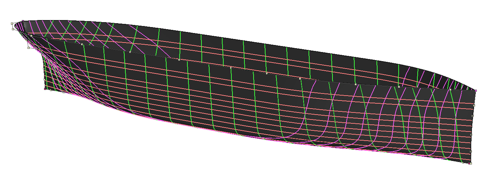{width=100%}

The 3D hull view has buttons around its edges for rotating the view. You can also rotate with **Shift + middle mouse button** or the orbit icon {height=21px}.

Use the mouse wheel or the zoom icons {height=22px} to zoom in and out. Hold the middle mouse button to pan up, down, left or right, or use the pan icon {height=19px}. The centre icon {height=22px} centres the hull in the view. Toggle surface shading with the shading icon {height=20px}.

### Body Plan

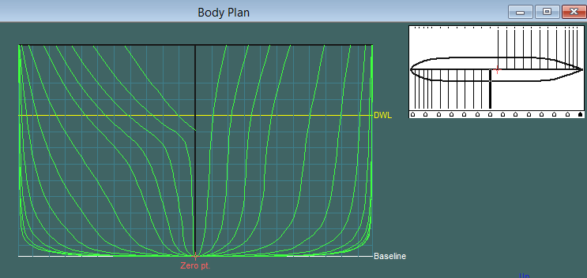{width=80%}

The **Body Plan** window displays the hull sections. Show or hide them with the contour button {height=28px}.

The small plan view at the top right of this window shows the hull from above. Its straight black lines mark the section positions (**stations**); the triangles mark control-net columns. The section-view workflow is described below in [Working in the Body Plan view](#working-in-the-body-plan-view).

### Profile

The **Profile** window displays the longitudinal curves called **buttocks**.

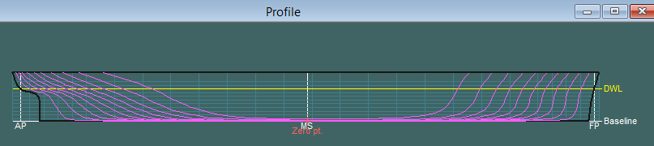{width=90%}

### Plan

The **Plan** window displays the waterlines.

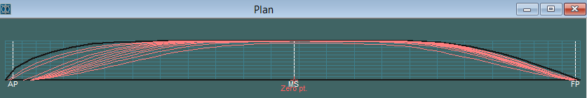{width=90%}

### Design Grid

Choose **Data → Design Grid** to edit the planes that create sections, waterlines and buttocks.

Use **Add** and **Delete** to change the number of intersections. After adding them, use **Space** to distribute them automatically along the hull; for example, you can space the stations evenly along its length.

For the hulls in these lessons, around 20 theoretical sections, up to 10 waterlines and up to 8 buttocks are usually enough to describe the shape.

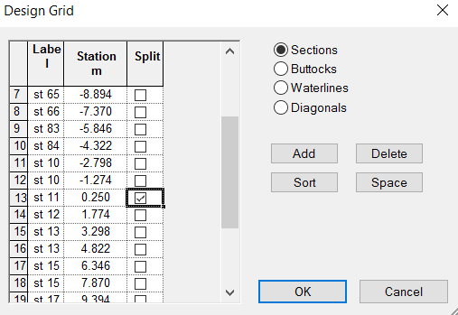{width=65%}

For sections, select the centre or main section with the **Split** checkbox. This divides the Body Plan view into the forward and aft halves of the hull. After choosing the split section, use the half-display icon {height=23px} to choose whether to show both symmetrical sides or only one.

## Working with surfaces

### NURBS

Maxsurf models hull curves and surfaces as NURBS. A curve is controlled by a polygonal chain of **control points**. Each point attracts the curve, and its influence can optionally be adjusted with a **weight**, as shown below.

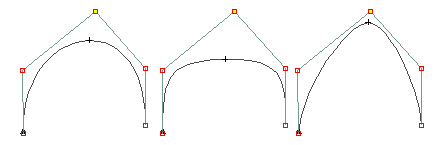{width=55%}

Surfaces work similarly, but their control points form a two-dimensional **control net**.

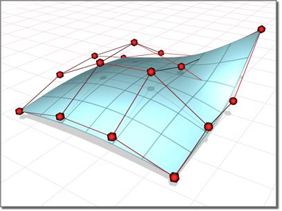{width=50%}

The **Assembly** window lists the surfaces. Select a surface, marker or control point to view its settings in **Properties**, or right-click it.

One important curve or surface setting is **stiffness**. Higher stiffness spreads a control point's influence over a wider area, which can make the curve smoother but harder to change locally.

### Editing surfaces

Add a simple surface from **Surfaces → Add Surface**. **Simple Yacht** creates a basic starter yacht hull.

Show or hide the control net with the control-net icon {height=25px}.

The net is easiest to inspect and edit in the **Plan** and **Profile** views. Editing it in the **Body Plan** view takes a different approach, described in the next section.

Select one or more control points (hold **Shift** to add points to the selection), then drag them with the left mouse button. Hold **Shift** while dragging to constrain the movement to the horizontal or vertical direction.

To give yourself more local control over the hull shape, add control points by adding a whole row or column with **Controls → Add**; remove them with **Controls → Delete**. Adding or deleting rows and columns changes the existing surface.

When the **Plan** or **Profile** view is active, use **Add/Delete Column**. When **Body Plan** is active, use **Add/Delete Row**.

Fewer control points make fairness easier to manage. Higher stiffness can smooth a net with more control points. Find a balance between surface stiffness and the number of rows and columns.

As a starting point, a simple hull can often be described by one surface with 5–7 rows across its height and 7–15 columns along its length. Start with fewer rows and columns, then add them only where you need more control over the shape.

In the **Plan** and **Profile** views, the control net should not cross over itself as in this example:

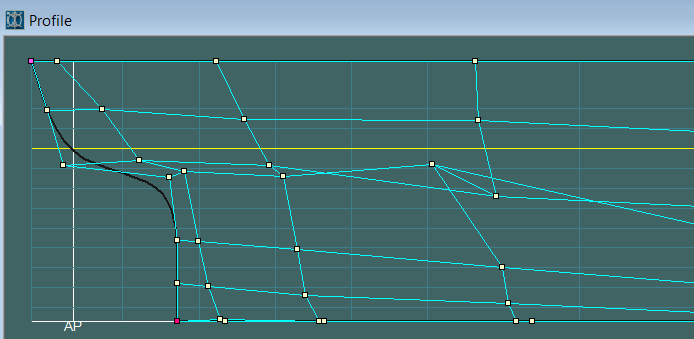{width=75%}

The pink control points mark the four corner points of the net.

### Working in the Body Plan view

After creating the initial surface shape, you can refine it in the **Body Plan** view.

The control net is clearer in **Plan** and **Profile** than in **Body Plan**. Hide it in Body Plan with the control-net icon {height=25px}.

You can also choose whether to show all sections or only the section you are editing with the section-display buttons {height=18px}.

For practice, align a control-net column with a section at the same longitudinal X position. In **Plan**, arranging the net to follow the waterlines can also help produce a smoother surface.

In the small plan view, click a triangle to select the control-net column you want to edit {height=29px}.

After you click a triangle, Maxsurf displays the nearest section. The example below has the other sections hidden so only that section is visible.

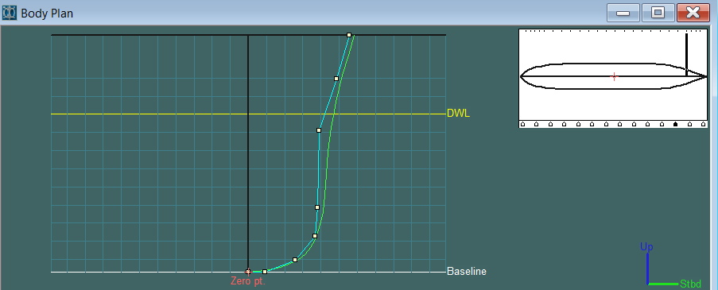{width=80%}

Move the displayed square control points to change the selected column and modify the nearby sections. The number of neighbouring sections affected depends on the surface's **stiffness**: lower stiffness makes it easier to move a local area; higher stiffness makes it harder to move a point but spreads its effect farther.

Clicking a black line in the small plan view (above the triangles) changes only which section is displayed; it does not change the selected control-net column.

With all sections visible, moving a control point shows how the whole hull shape changes:

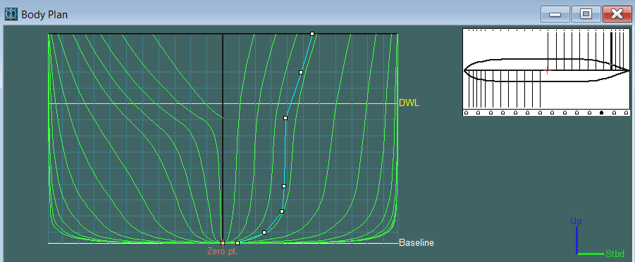{width=80%}

The example places more control points near the bottom of the hull, where its shape is more curved. In general, use more control points where the shape is more complex.

Model the hull one control-net column at a time: click a triangle, adjust the section, then move to the next triangle. When you reach the end, repeat the pass. Work iteratively until the shape is fair.

Moving one control point changes the nearest section and may also change neighbouring sections because of the point's influence on the NURBS surface. That is why you should make repeated, small passes.

If you have set a split section in the Design Grid, use **Half** to choose whether the view shows the aft or forward half.

### Working in the other views

Refining the sections in **Body Plan** is important for a fair hull. A fair surface also has a fair control net: the net should expand and contract gradually in the other views, and rise or fall gradually.

Examples of a fair control net:

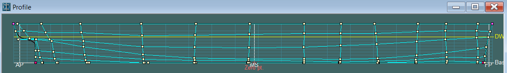{width=95%}

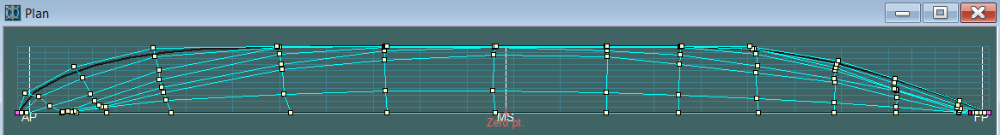{width=95%}

The corresponding sections of this fair surface look like this:

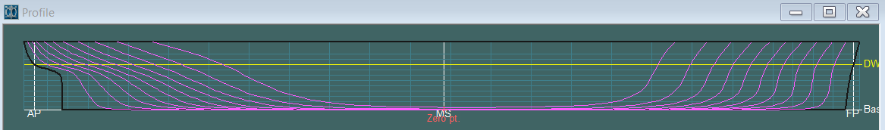{width=95%}

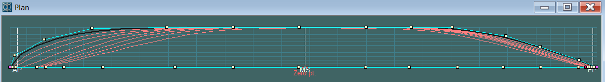{width=95%}

When changing views, show or hide the control net as needed, and use the icons to show or hide surface contours.

## Finishing the surface

### Fairness of sections

The hull shape should be smooth. In mathematical terms, its curves should have smooth derivatives.

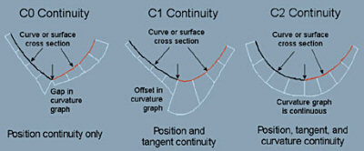{width=45%}

The curve's derivatives are shown as a comb-like graph, called a **curvature graph** or **curvature comb**. Select a curve, then toggle its curvature display with the curvature icons {height=17px}.

Move the control points gently to make a smooth curve without sudden jumps in the curvature graph. The graph may change from positive to negative, crossing to the other side of the curve; aim for a smooth transition without abrupt jumps.

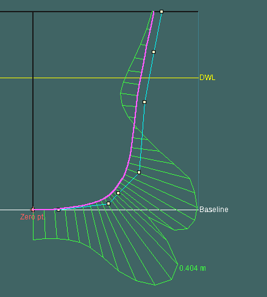{width=48%}

At the bow and stern, the curve may naturally change curvature through an inflection point. In the example above, the upper transition is appropriate, but the lower jump is unnecessary. The curve can be improved by spreading apart the closely spaced control points near that jump.

The corrected section curve looks like this:

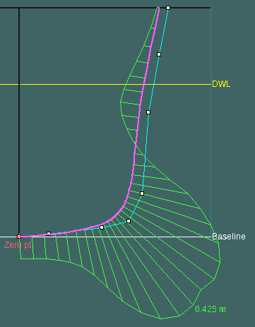{width=45%}

### Fairness of the surface

The surface's overall fairness is shown with colours on the hull. With the **Perspective** window active, use the shading icon to control the 3D display.

Choose **Display → Render** to adjust the surface and curvature display. The options include:

**Longitudinal curvature**

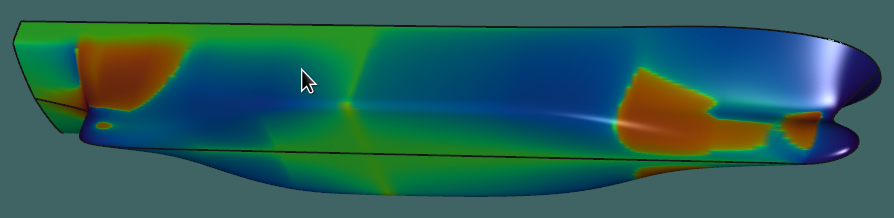{width=90%}

**Transverse curvature**

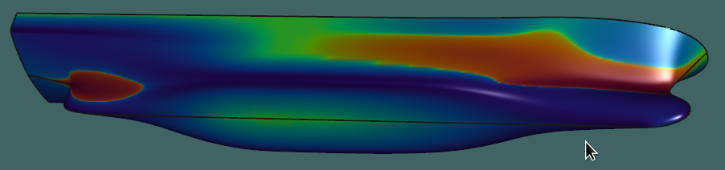{width=90%}

**Overall convexity**

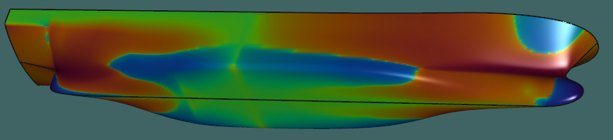{width=90%}

Turn off the curvature colours with **Smooth Shading** in the Render window. **Render Mesh Precision** sets the accuracy of the shaded display.

### Other useful commands

**Data → Frame of Reference** opens the window for setting or changing the origin (**Zero PT**), design waterline (**DWL**) and perpendiculars (**Aft Perp.** and **Fwd Perp.**).

**Data → Calculate Hydrostatics** reports hydrostatic properties of the hull form.

## Working with markers

### Entering markers

Markers are virtual points in space.

If you have an existing hull form to work from, read as many points as possible from its sections and enter them in Maxsurf. You can then shape a surface to fit those markers. Read at least five points from each section and enter them in a shared table.

The example shows markers on a section. The intersections WL5, WL6, Bu1 and Bu2 help identify each point's transverse and vertical positions.

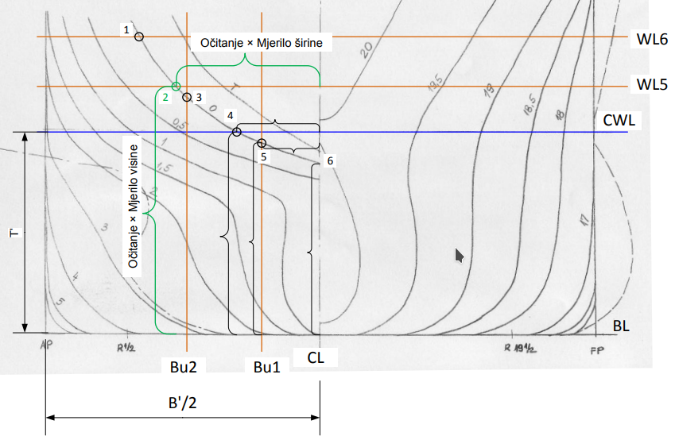{width=65%}

Use **X** for the longitudinal axis, **Y** for offset and **Z** for height. A marker table in metres might look like this:

| Station | Longitudinal (X) | Offset (Y) | Height (Z) |
|---:|---:|---:|---:|
| 1 | 0.000 | 0.000 | 0.000 |
| 1 | 0.000 | 4.000 | 0.000 |
| 1 | 0.000 | 6.240 | 0.560 |
| 1 | 0.000 | 7.340 | 1.333 |
| 1 | 0.000 | 7.600 | 5.500 |
| 2 | 3.500 | 0.000 | 0.000 |
| 2 | 3.500 | 4.000 | 0.000 |
| 2 | 3.500 | 6.300 | 0.630 |
| 2 | 3.500 | 7.420 | 1.520 |
| 2 | 3.500 | 7.700 | 5.500 |
| … | … | … | … |

For example, place the origin at the aft perpendicular (**AP**) on the centreline (**CL**). The section at AP then has **X = 0**; with this course's X-forward convention, sections forward of AP have **X > 0**.

Maxsurf expects numbered stations starting at 1. **Offset (Y)** is always positive, even though body-plan drawings often show the bow and stern on opposite sides of the centreline.

The table shows only two stations, with five points per station. All points on one section have the same X coordinate because a section lies in a YZ plane.

You can type the table directly into Maxsurf or prepare it in Excel and copy it over. Choose **Window → Markers** to open the marker table. Make that window active, then choose **Markers → Add Markers** to add rows. Enter one row for each measured point.

After entering or pasting the data, enable the marker-display button {height=26px} to show the markers in the views. To connect the markers within each section, use the connect-markers icon {height=19px}.

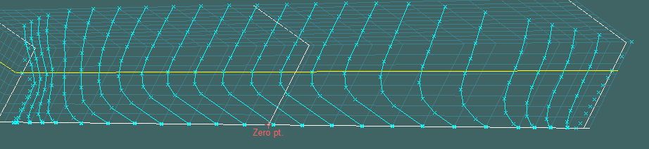{width=90%}

It is useful to make the Design Grid match the markers. Choose **Markers → Generate Design Grid from Markers** to create sections at the marker positions. If the markers connect in an unexpected order even though their coordinates are correct, try **Markers → Sort Markers within Stations**.

### Modelling a surface to fit markers

There are several ways to make a surface fit the markers. This manual method is flexible:

1. After entering the markers, add a starter surface with **Surfaces → Add Surface → Simple Yacht**.
2. Show the control net. Set its control points to the hull's length, width and height, then add enough rows and columns (see [Editing surfaces](#editing-surfaces)).
3. When the net is ready, follow the steps in [Working in the Body Plan view](#working-in-the-body-plan-view).
4. In the Body Plan view, you can show only the markers for the section you are editing with the marker-display controls.

If the sections are close together, one control-net column for every other section may be enough. For practice, try one column per section.

---

Adapted and translated from [*Uvod u Maxsurf*](https://jobasic-geometry.curve.space/uvod-u-maxsurf), Josip Bašić, 4 October 2024. The original illustrations are retained.
